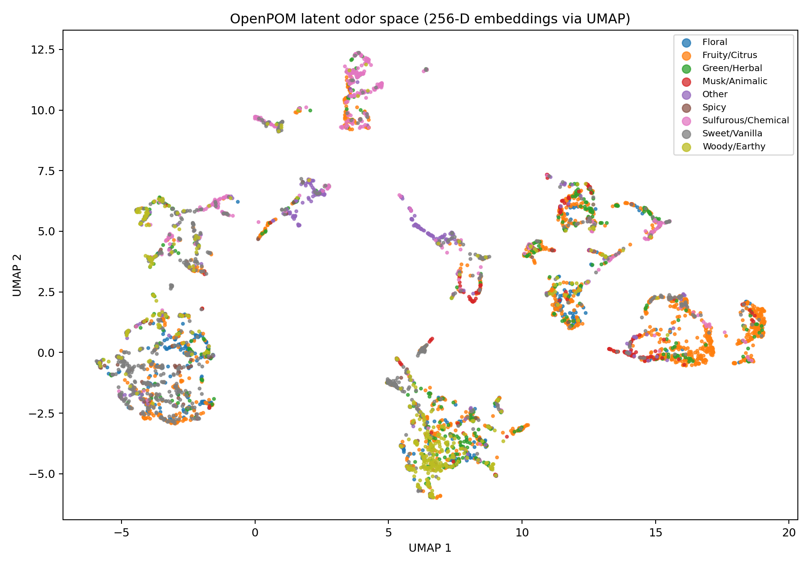
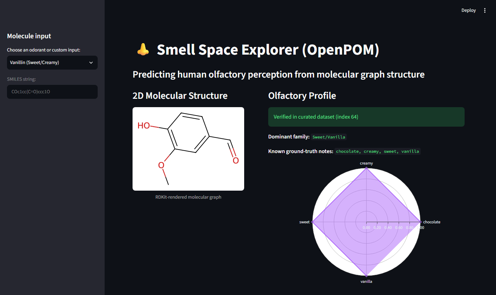

# Smell Space Explorer

Smell Space Explorer predicts human olfactory descriptors from molecular
structure with **OpenPOM**, a multi-task message-passing neural network built on
DeepChem, DGL-LifeSci, and RDKit. It maps each molecule to a 256-dimensional
principal odor embedding, projects the curated ~4,983-molecule odor dataset with
UMAP, and provides nearest-neighbor retrieval plus a cross-scaffold discovery
analysis in a Streamlit app. The goal is exploratory: find molecules that are
structurally dissimilar (low Morgan/Tanimoto similarity) but perceptually close
(high cosine similarity in OpenPOM space).

> **Status:** the notebook refactor, real checkpoint-backed inference,
> similarity optimizations, evaluation, and test suite are complete. Unseen
> molecules run through the trained MPNN and receive probabilities for all 138
> descriptors plus a 256-D embedding; no fallback predictions are used. See
> [Limitations](#limitations) and the [evaluation protocol](#evaluation).

## Screenshots





## Project structure

```text
smell-space-explorer/
  .github/workflows/tests.yml   # checkpoint-free CI
  app/streamlit_app.py
  data/                         # downloaded CSV and DeepChem cache (ignored)
  models/                       # checkpoints (ignored)
  notebooks/demo.ipynb          # thin, output-free demo
  results/
    embeddings/                 # embeddings and cached cosine matrix (ignored)
    figures/                    # UMAP and app screenshots used by this README
    splits/                     # seed-42 split indices and prevalence CSV
    metrics.json                # evaluation summary
    metrics_per_task.csv        # per-descriptor AUROC
  scripts/
    create_split.py
    train.py
    evaluate_split.py
    extract_embeddings.py
    find_cross_scaffold_pairs.py
    patch_dgl.py
  src/smell_space/
    config.py                   # paths and environment overrides
    data.py                     # data, splits, hash-keyed cache, featurization
    model.py                    # OpenPOM construction and training
    evaluation.py               # per-task / macro / micro AUROC
    embeddings.py               # 256-D extraction and UMAP
    inference.py                # single-molecule inference
    similarity.py               # cosine retrieval and scaffold discovery
  tests/
    reference.py                # original loop implementations for equivalence
```

## Installation

The scientific stack is pinned for **Python 3.10** (DeepChem 2.8 does not
support Python 3.12+). A virtual environment is strongly recommended.

```bash
python3.10 -m venv .venv
source .venv/bin/activate          # Windows: .venv\Scripts\activate
python -m pip install --upgrade pip setuptools wheel

# CPU-only PyTorch first, so pip does not pull a full CUDA build.
pip install torch==2.1.2 --index-url https://download.pytorch.org/whl/cpu

pip install -r requirements.txt
pip install -e . --no-deps

# If DGL fails to import because of the optional GraphBolt extension:
python scripts/patch_dgl.py
```

The editable install was verified in the project's Python 3.10 conda
environment with `pip install -e . --no-deps`, followed by
`python -c "import smell_space"` from outside the repository. The exact
dependency versions in that working environment may differ from the pinned
set; treat the pins as a reproducible starting point.

### DGL GraphBolt note

Some DGL/PyTorch combinations fail while importing DGL's optional GraphBolt
extension even though OpenPOM does not use GraphBolt. The repository includes an
idempotent helper that installs the minimal stub used by the original notebook:

```bash
python scripts/patch_dgl.py
```

The script finds `dgl/graphbolt/__init__.py` through `sys.prefix` and
`site.getsitepackages()` without importing `dgl` first, so it works when
`import dgl` itself is failing. Running it more than once is safe: it reports
`already patched` if the stub is already present. The stub disables GraphBolt
globally, so apply it only when the import error requires it.

## Data

The curated CSV is downloaded automatically from the OpenPOM repository on
first use and stored at `data/curated_GS_LF_merged_4983.csv`. It contains 4,983
molecules and 138 binary odor descriptors.

Paths can be overridden without editing code:

| Variable | Default |
| --- | --- |
| `SMELL_DATA_DIR` | `<repo>/data` |
| `SMELL_DATASET_PATH` | `<data>/curated_GS_LF_merged_4983.csv` |
| `SMELL_CACHE_DIR` | `<data>/disk_dataset` |
| `SMELL_MODELS_DIR` | `<repo>/models` |
| `SMELL_MODEL_DIR` | `<models>/openpom_scaffold` |
| `SMELL_RESULTS_DIR` | `<repo>/results` |

Relative values are resolved against the repository root.

## Train

```bash
python scripts/train.py --epochs 25
```

Training writes DeepChem checkpoints under `models/openpom_scaffold/`. Use
`--resume` to continue from the most recent checkpoint. Training on CPU is
expensive; GPU is not required by the code but is supported by the underlying
stack. The default schedule and model hyperparameters match the original
notebook.

Optional training controls are off by default so the default run is unchanged:

| Flag | Default | Effect |
| --- | --- | --- |
| `--eval-every N` | `5` | Evaluate every N epochs, plus the first and last. |
| `--train-eval-max-samples N` | `0` | Evaluate train AUROC on N random molecules; `0` uses the full train set. |
| `--valid-fraction F` | `0` | Hold out a stratified validation fraction; `0` keeps train = validation as before. |
| `--split-file PATH` | unset | Use a saved train/valid/test split; training consumes only train and valid. |
| `--early-stopping-patience N` | `0` | Stop after N evaluations without validation-AUROC improvement; requires `--valid-fraction`. |
| `--save-best-checkpoint` | off | Restore and save the best validation weights. |
| `--seed N` | unset | Seed Python/NumPy/PyTorch and the split; omit to preserve the original non-seeded behavior. |

Example opt-in run:

```bash
python scripts/train.py \
  --epochs 30 \
  --valid-fraction 0.1 \
  --early-stopping-patience 3 \
  --train-eval-max-samples 512 \
  --save-best-checkpoint \
  --seed 42
```

## Build embeddings and the UMAP map

Generate artifacts only after a checkpoint exists:

```bash
python scripts/extract_embeddings.py
```

This writes:

- `results/embeddings/openpom_embeddings_256d.npy` — shape `(n_molecules, 256)`
- `results/embeddings/openpom_cosine_similarity_float32.npy` — cached cosine matrix
- `results/embeddings/molecules_metadata_umap.csv`
- `results/figures/umap.png`
- `results/figures/umap.html`

## Run the Streamlit app

```bash
streamlit run app/streamlit_app.py
```

Known dataset entries show their curated labels, UMAP position, and nearest
neighbors. For an unseen SMILES, the app runs the trained MPNN, displays the top
predicted descriptors and radar chart, and retrieves nearest neighbors using
that query's own 256-D embedding. If no checkpoint exists, the app shows an
instruction to run `scripts/train.py`; it never displays fabricated
predictions.

### Single-molecule inference API

```python
from smell_space.inference import predict_odor_profile

result = predict_odor_profile("COc1cc(C=O)ccc1O", top_n=5)
print(result.top_predictions)          # five highest probabilities
print(len(result.probabilities))      # all 138, sorted descending
print(result.embedding.shape)         # (256,)
```

The model, featurizer, and task names are loaded lazily once per process and
reused. Invalid SMILES raise `ValueError`; a missing checkpoint raises
`FileNotFoundError` with the training command. Re-run
`scripts/extract_embeddings.py` whenever you train a new checkpoint so the
dataset embeddings and the query model come from the same weights.

## Cross-scaffold discovery

```bash
python scripts/find_cross_scaffold_pairs.py --num-pairs 5
```

The default criteria are OpenPOM cosine **> 0.88** and Morgan (ECFP4) Tanimoto
**< 0.32**; both are command-line parameters. Results are written to
`results/retrieval/cross_scaffold_pairs.csv` and rendered to
`results/figures/cross_scaffold_pairs.png`.

## Evaluation

These numbers come from the separate evaluation checkpoint
`models/openpom_eval_split42`, **not** from the production checkpoint used by
the app.

| Split | Macro AUROC | Micro AUROC | Tasks evaluated | Tasks skipped |
| --- | --- | --- | --- | --- |
| Test | 0.861950 | 0.911583 | 138 | 0 |
| Validation | 0.862595 | 0.912782 | 138 | 0 |
| Train | 0.925423 | 0.949411 | 138 | 0 |

Macro AUROC is the unweighted mean of the evaluable per-task AUROCs; mean
per-task AUROC is therefore the same value. All 138 descriptors had both classes
in every split, so no tasks were skipped. Raw full-precision values and the
per-task table are in [`results/metrics.json`](results/metrics.json) and
[`results/metrics_per_task.csv`](results/metrics_per_task.csv).

### Evaluation protocol

- Split method: `MultilabelStratifiedKFold(n_splits=10, shuffle=True,
  random_state=42)` from `iterative-stratification`, with 8 folds for training,
  1 for validation, and 1 for test.
- Split sizes: **3,987 train / 498 validation / 498 test**.
- Dataset SHA-256: `0c18b6e9f0f99b772203ba4da30a96b3d60db700349376cbafe23512a9baa704`.
- Split hash: `aa917375bd24e139788d83bcd9da1949c3ebe2e4dae6209205bc71bf97986015`.
- Model: same architecture and hyperparameters as the production model, trained
  on the train split only for 30 epochs, with best-validation checkpoint restore
  (best validation AUROC 0.8626 at epoch 27).
- The test split was predicted exactly once, after training. It was not used for
  early stopping, model selection, or hyperparameter tuning.
- Evaluation code commit: `2ca211b6a9fd1001dc9ab3b14a38e41f5d5dbdd0`.

**Production model caveat:** the checkpoint used by the Streamlit app
(`models/openpom_scaffold`) was trained on the **full 4,983-molecule dataset**,
as established from its 25 full-data epochs and the original
`train_model(model, dataset, dataset)` code. Dataset molecules shown as
"verified" in the app were therefore seen during training; their curated labels
are not held-out predictions. Only the numbers above, from
`openpom_eval_split42`, are held-out evaluation results.

### Leakage checks

- Exact duplicate `nonStereoSMILES` across splits: **0**.
- Canonical-SMILES duplicates across splits: **0**.
- Binary ECFP4 near-duplicate pairs at Tanimoto ≥ 0.99: **222 train–valid**,
  **271 train–test**, **23 valid–test**. These are fingerprint collisions among
  long aliphatic chains with different lengths (for example, C8/C12/C16 fatty
  acids), not duplicate source records. The test macro AUROC (0.86195) is not
  anomalously high; no split or metric was changed after this check.

## Tests

```bash
pytest
```

The suite covers invalid SMILES handling, vectorized Tanimoto equivalence
against the original RDKit loops, top-k `argpartition` equivalence, cosine-cache
round trips, the CSV-hash cache rebuild, deterministic multi-label split
behavior, AUROC aggregation, the 138-task column contract, and embedding shape.
Model-dependent tests are marked `slow` and skip when no checkpoint or dataset
is available. The local suite currently reports **20 passed**; without a
checkpoint it reports **19 passed, 1 skipped**.

GitHub Actions runs the checkpoint-free suite on Python 3.10. The tests do not
import DGL, so the workflow does not apply the GraphBolt stub. The workflow has
not been executed on GitHub from this local environment.

The notebook is output-free. To keep it that way, install `nbstripout` once:

```bash
nbstripout --install
```

## Model weights and embeddings

`models/*.pt`, `results/embeddings/*.npy`, and generated CSVs are git-ignored
because they are large build artifacts. Publish them through a GitHub Release
and document the download command, or track them with Git LFS if the host
supports it:

```bash
git lfs install
git lfs track "results/embeddings/*.npy" "models/**/*.pt"
git add .gitattributes
```

The trained checkpoints and the 256-D embedding matrix are not included in this
repository. The evaluation checkpoint is also local-only under
`models/openpom_eval_split42/`.

## Reproducibility

- The UMAP projection uses `n_neighbors=15`, `min_dist=0.1`, cosine metric, and
  `random_state=42`.
- `--seed N` seeds Python, NumPy, PyTorch, and the validation split. Seeding is
  opt-in so the default training path remains unchanged.
- The DeepChem featurization cache stores the source CSV SHA-256 and is rebuilt
  when that digest, the task columns, or the cache version changes.
- The 256-D cosine matrix is cached as float32 and reused by the app.
- The evaluation split, dataset hash, split hash, seed, epochs, and code commit
  are recorded in `results/splits/split_seed42.json` and `results/metrics.json`.
- Exact numerical reproduction also depends on the installed
  PyTorch/DGL/DeepChem versions and CPU/GPU kernels.

## Credits and citations

This project builds directly on:

- **OpenPOM** — [ARY2260/openpom](https://github.com/ARY2260/openpom).
  Lee, B. K. et al. "A principal odor map unifies diverse tasks in olfactory
  perception." *Science* 381, 999–1006 (2023).
  [doi:10.1126/science.ade4401](https://doi.org/10.1126/science.ade4401)
- **DeepChem** — [deepchem.io](https://deepchem.io/).
- **DGL-LifeSci** — [awslabs/dgl-lifesci](https://github.com/awslabs/dgl-lifesci).
- **RDKit** — [rdkit.org](https://www.rdkit.org/).
- **UMAP** — McInnes, L., Healy, J., & Melville, J. "UMAP: Uniform Manifold
  Approximation and Projection for Dimension Reduction." arXiv:1802.03426
  (2018).
- **GoodScents / Leffingwell odor data** — the curated OpenPOM dataset merges
  records derived from the Good Scents Company and Leffingwell & Associates
  databases. Refer to the OpenPOM data documentation for provenance and terms.

## License

This repository's original code is released under the MIT License; see
[LICENSE](LICENSE). **TODO:** verify that the OpenPOM code and model weights and
the GoodScents/Leffingwell-derived dataset permit redistribution and commercial
use under compatible terms before publishing artifacts.

## Limitations

Predictions are produced by a model trained on roughly 5,000 molecules and are
**not experimental ground truth**. Odor perception is context-dependent,
subject-dependent, and can be influenced by concentration and mixtures. The
training labels are aggregated from heterogeneous sources and are sparse;
many descriptors have few positives. A high cosine similarity in OpenPOM space
is a model-based hypothesis, not proof that two molecules smell alike.
Out-of-distribution chemistries — especially large, unusual, or poorly
represented scaffolds — are expected to be less reliable and may still produce
confident-looking probabilities. Do not use this project for safety, toxicity,
allergenicity, regulatory, or formulation decisions without independent
experimental validation.
